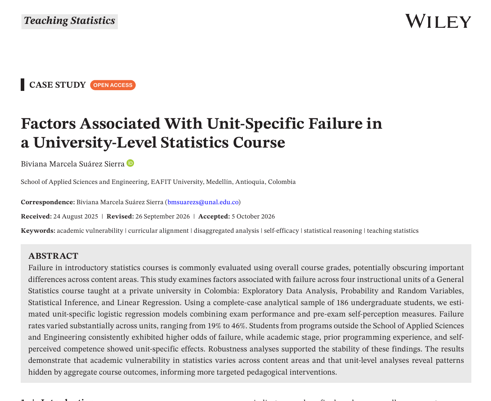
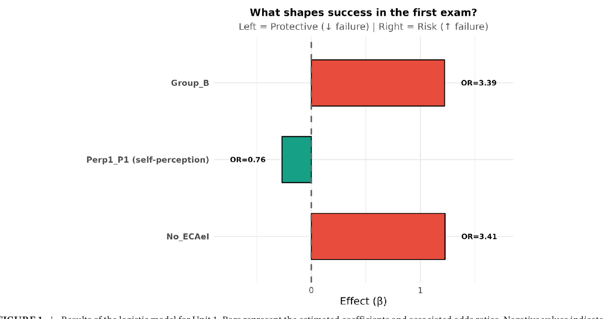
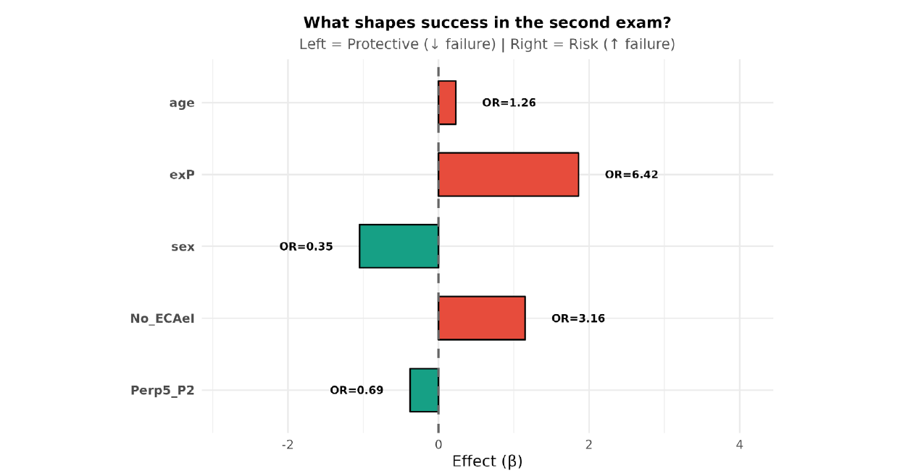
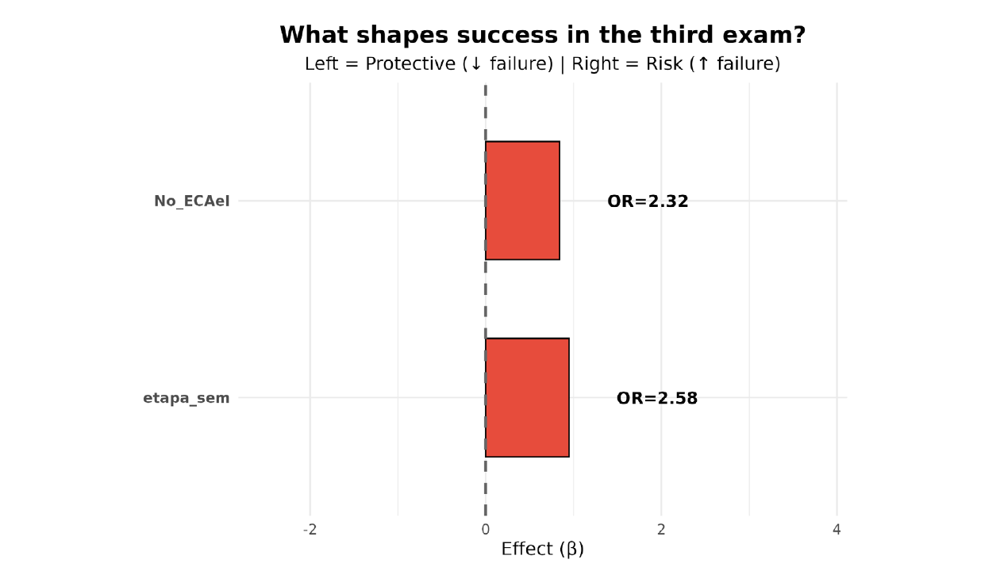
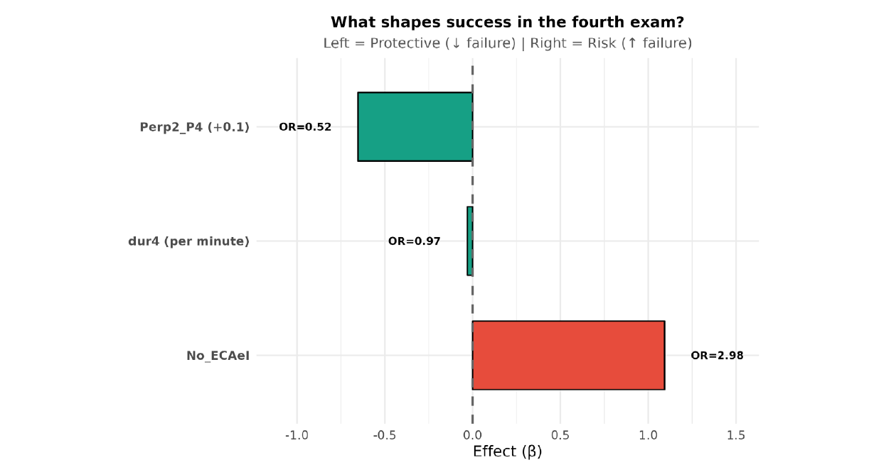

```{r}
#| include: false
library(ggplot2)

verde <- "#5F8D4E"
verde_oscuro <- "#2F5D3A"
verde_claro <- "#B9D095"

theme_set(
  theme_minimal(base_size = 17) +
    theme(
      plot.title = element_text(face = "bold", colour = verde_oscuro, size = 22),
      plot.subtitle = element_text(size = 14, colour = "#555555"),
      panel.grid.minor = element_blank(),
      axis.title = element_text(size = 14),
      axis.text = element_text(size = 13),
      legend.position = "bottom"
    )
)
```

## {.title-slide-custom}

<div class="event-tag">Conferencia LIV JEM · Licenciatura en Matemáticas UPN</div>

<div class="talk-title">Una nota final no cuenta toda la historia</div>
<div class="talk-subtitle">¿Dónde fracasa el aprendizaje de la estadística?</div>

<div class="speaker">
<strong>Biviana Marcela Suárez Sierra</strong><br>
Profesora asistente · Departamento de Matemáticas<br>
Universidad de los Andes<br>
Egresada de la Licenciatura en Matemáticas · UPN
</div>

<div class="event-info">
<strong>10 de noviembre de 2026 · 4:00 p. m.</strong><br>
Universidad Pedagógica Nacional · Calle 72
</div>

::: {.notes}
**Tiempo sugerido: 1 min.** Agradecer la invitación y plantear desde el inicio que la charla no preguntará solo “quién reprueba”, sino “en qué momento y frente a qué contenidos aparece la dificultad”.
:::

## El artículo detrás de esta charla

:::: {.columns}
::: {.column width="46%"}
{fig-alt="Recorte de la primera página de la versión publicada en Teaching Statistics" width="96%" .paper-image}

<div class="source-note">Recorte de la primera página de la versión publicada en <em>Teaching Statistics</em> (Wiley, 2026).</div>
:::

::: {.column width="54%"}
<div class="paper-card">
<div class="paper-journal">Teaching Statistics · Wiley</div>
<div class="paper-title">Factors Associated With Unit-Specific Failure in a University-Level Statistics Course</div>
<div class="paper-meta">
Biviana Marcela Suárez Sierra<br>
Publicado en línea: <strong>25 de octubre de 2026</strong><br>
DOI: <a href="https://doi.org/10.1002/test.70055">10.1002/test.70055</a>
</div>
</div>

<br>

**Idea central del artículo:** una nota global puede ocultar diferencias sustantivas entre contenidos y, por tanto, ocultar **cuándo**, **en qué** y **para quién** aparece la vulnerabilidad académica.

<div class="center qr-row">
{fig-alt="Código QR al artículo publicado" width="24%"}
<span class="small">Artículo publicado</span>
</div>
:::
::::

::: {.notes}
**Tiempo: 2 min.** Señalar que la charla se basa en la versión publicada en Teaching Statistics. La imagen corresponde directamente al PDF editorial publicado; el QR lleva al artículo.
:::

## La pregunta que motiva el trabajo

<div class="big-question">
¿Dos estudiantes con la misma nota final<br>tuvieron realmente la misma experiencia de aprendizaje?
</div>

<br>

:::: {.columns}
::: {.column width="50%"}
### Estudiante A

| Unidad | Nota |
|---|---:|
| Descriptiva | 2.3 |
| Probabilidad | 4.1 |
| Inferencia | 2.5 |
| Regresión | 4.0 |
:::
::: {.column width="50%"}
### Estudiante B

| Unidad | Nota |
|---|---:|
| Descriptiva | 3.4 |
| Probabilidad | 3.2 |
| Inferencia | 3.1 |
| Regresión | 3.2 |
:::
::::

<div class="small muted center">Ejemplo conceptual: el promedio puede ser parecido y, sin embargo, los perfiles de aprendizaje ser radicalmente distintos.</div>

::: {.notes}
**Tiempo: 2 min.** Preguntar al público qué información perderíamos si solo observamos la definitiva.
:::

## Marco teórico: aprender estadística es multidimensional

:::: {.columns}
::: {.column width="25%"}
<div class="dimension-card">
<div class="dimension-title">Cognitiva</div>
Preparación matemática y computacional, razonamiento estadístico, integración conceptual y etapa académica.
</div>
:::
::: {.column width="25%"}
<div class="dimension-card">
<div class="dimension-title">Afectiva</div>
Actitudes, autoeficacia, competencia percibida, interés, esfuerzo y dificultad percibida.
</div>
:::
::: {.column width="25%"}
<div class="dimension-card">
<div class="dimension-title">Pedagógica</div>
Sección, prácticas de enseñanza, evaluación, laboratorio, contextualización y secuenciación de contenidos.
</div>
:::
::: {.column width="25%"}
<div class="dimension-card">
<div class="dimension-title">Contextual</div>
Programa académico, trayectoria previa, características demográficas y entorno educativo.
</div>
:::
::::

<div class="takeaway">El artículo organiza los predictores en estas cuatro dimensiones como un <strong>marco interpretativo</strong>, no como compartimentos mutuamente excluyentes.</div>

::: {.notes}
**Tiempo: 2 min.** Esta diapositiva sirve como mapa de todo lo que sigue. Burns et al. (2020), Rabin et al. (2021) y Fabbricatore et al. (2023) sostienen la idea de desempeño multidimensional.
:::

## 1 · Razonamiento estadístico y dificultad conceptual

:::: {.columns}
::: {.column width="56%"}
- Muchos estudiantes desarrollan **destreza procedimental** sin una comprensión conceptual profunda.
- Datos pueden ser vistos como valores aislados, en lugar de un **agregado con propiedades emergentes**.
- La variabilidad se reduce con frecuencia a “calcular una desviación”, sin conectarla con muestreo e inferencia.
- Inferencia exige integrar **distribución, muestreo, incertidumbre y variabilidad**.
:::
::: {.column width="44%"}
<div class="concept-flow">
<div>Datos + contexto</div>
<div>↓</div>
<div>Alfabetización estadística</div>
<div>↓</div>
<div>Razonamiento estadístico</div>
<div>↓</div>
<div>Pensamiento estadístico</div>
</div>
:::
::::

<div class="takeaway">Garfield y Ben-Zvi: enseñar estadística no puede reducirse a una colección fragmentada de técnicas; se necesita <strong>integración conceptual</strong>.</div>

<div class="source-note">Garfield & Ben-Zvi (2007); Garfield et al. (2008); Olani et al. (2011).</div>

::: {.notes}
**Tiempo: 2 min.** Conectar con el resultado de que una unidad aparentemente “básica” como descriptiva también puede concentrar dificultades.
:::

## 2 · Actitudes, autoeficacia y competencia percibida

:::: {.columns}
::: {.column width="54%"style="font-size: 0.78em;"}
**Autoeficacia**: creencia del estudiante sobre su capacidad para realizar con éxito una tarea específica.

- Puede afectar persistencia, dedicación y respuesta frente a la dificultad.
- La **competencia cognitiva percibida** se ha asociado con desempeño en estadística.
- Las actitudes pueden ser resistentes al cambio e incluso deteriorarse durante el curso.
- El SATS-36 organiza actitudes en **Afecto, Competencia cognitiva, Valor, Dificultad, Interés y Esfuerzo**.
:::
::: {.column width="46%"}
<div class="caution">
<strong>Importante:</strong> en este estudio no se aplicó el SATS-36 completo. Antes de cada examen se preguntó por la <strong>competencia percibida en resultados de aprendizaje específicos</strong> de esa unidad.
</div>

<br>

<div class="takeaway">No es lo mismo preguntar “¿soy bueno para estadística?” que “¿me siento capaz de probar e interpretar un coeficiente de regresión?”.</div>
:::
::::

<div class="source-note">Bandura (1997); Finney & Schraw (2003); Dempster & McCorry (2009); Gal & Ginsburg (1994); Ghulami et al. (2015).</div>

::: {.notes}
**Tiempo: 2 min.** Explicar por qué las preguntas de autopercepción son específicas de la unidad y no una actitud general.
:::

## 3 · Diferencias disciplinares y diseño pedagógico

:::: {.columns}
::: {.column width="50%" style="font-size: 0.78em;"}
### Diferencias disciplinares

- Estudiantes de áreas STEM suelen llegar con mayor exposición matemática y computacional.
- En programas no cuantitativos pueden coexistir menor preparación previa, menor confianza y mayor ansiedad estadística.
- Las habilidades matemáticas básicas han mostrado una asociación importante con desempeño en cursos introductorios.
:::
::: {.column width="50%"style="font-size: 0.78em;"}
### Modernizar la enseñanza

- Menos énfasis exclusivo en cálculo manual.
- Más interpretación, argumentación y toma de decisiones en contextos auténticos.
- Proyectos y actividades aplicadas.
- Integración entre clase y laboratorio.
- En este curso, el pensamiento computacional con **R** tiene un papel central.
:::
::::

<div class="takeaway">Esto lleva a una hipótesis pedagógica fuerte: <strong>los factores asociados al fracaso pueden depender del contenido que se esté aprendiendo</strong>.</div>

<div class="source-note">Rabin et al. (2021); Fabbricatore et al. (2023); Burns & Hammond (2019).</div>

::: {.notes}
**Tiempo: 2 min.** Conectar esta diapositiva con la decisión metodológica de desagregar por unidad.
:::

## El diseño del estudio

:::: {.columns}
::: {.column width="31%"}
<div class="stat-box"><div class="num">186</div><div class="lab">estudiantes en la muestra analítica común</div></div>
:::
::: {.column width="31%"}
<div class="stat-box"><div class="num">4</div><div class="lab">unidades y cuatro evaluaciones digitales</div></div>
:::
::: {.column width="31%"}
<div class="stat-box"><div class="num">3.0/5.0</div><div class="lab">umbral institucional de aprobación</div></div>
:::
::::

<br>

**Antes de cada examen:** encuesta breve de autopercepción sobre los resultados de aprendizaje de la unidad.  
**Modelación principal:** cuatro regresiones logísticas, una por unidad.  
**Predictores:** variables de preparación académica, autopercepción, contexto, sección y condiciones del examen.

<div class="caution">Diseño observacional: se interpretan <strong>asociaciones</strong>, no efectos causales.</div>

::: {.notes}
**Tiempo: 2 min.** Mencionar que había 216 estudiantes con notas en los cuatro exámenes y 186 casos completos usados de manera común para facilitar comparaciones.
:::

## La primera señal: la reprobación cambia por unidad

```{r}
#| fig-width: 10
#| fig-height: 2.7
#| out-width: "78%"
#| fig-align: center
fallo <- data.frame(
  unidad = factor(c("Descriptiva", "Probabilidad\ny variables aleatorias", "Inferencia", "Regresión"),
                  levels = c("Descriptiva", "Probabilidad\ny variables aleatorias", "Inferencia", "Regresión")),
  tasa = c(46, 19, 40, 30)
)

ggplot(fallo, aes(unidad, tasa)) +
  geom_col(fill = verde, width = .66) +
  geom_text(aes(label = paste0(tasa, "%")), vjust = -0.35, size = 6, fontface = "bold", colour = verde_oscuro) +
  scale_y_continuous(limits = c(0, 52), breaks = seq(0,50,10), labels = function(x) paste0(x, "%")) +
  labs(x = NULL, y = "Tasa de reprobación", title = NULL) +
  theme(axis.text.x = element_text(face = "bold"))
```

<div class="takeaway"><strong>46%, 19%, 40%, 30%:</strong> la vulnerabilidad académica no es homogénea durante el semestre.</div>

::: {.notes}
**Tiempo: 2 min.** Preguntar por qué Descriptiva aparece tan alta: usarlo para introducir los cuellos de botella conceptuales.
:::

## Incluso dentro de una unidad, no todo cuesta igual

:::: {.columns}
::: {.column width="33%"}
<div class="stat-box"><div class="num">23.66%</div><div class="lab">resolvió correctamente el ítem que combinaba tendencia central, posición y dispersión</div></div>
:::
::: {.column width="33%"}
<div class="stat-box"><div class="num">6.45%</div><div class="lab">resolvió correctamente un ejercicio integrador de pruebas de hipótesis</div></div>
:::
::: {.column width="33%"}
<div class="stat-box"><div class="num">47.31%</div><div class="lab">resolvió ejercicios de regresión lineal e interpretación de correlación</div></div>
:::
::::

<br>

Otros resultados de Inferencia: **39.25%** en distribución muestral de la varianza; **21.51%** en intervalos de confianza generales; **43.55%** en intervalos para la varianza.

<div class="takeaway">Desagregar permite localizar <strong>cuellos de botella conceptuales</strong>, no solo asignar una etiqueta global de “aprobó/reprobó”.</div>

::: {.notes}
**Tiempo: 2 min.** Esta diapositiva conecta directamente el marco teórico sobre razonamiento con los datos observados.
:::

## Cómo leer una regresión logística

<div class="formula-box">
$$
\log\left(\frac{p}{1-p}\right)=\beta_0+\beta_1x_1+\cdots+\beta_kx_k,
\qquad OR=e^{\beta}.
$$
</div>

:::: {.columns}
::: {.column width="50%" style="font-size: 0.78em;"}
### Si $\beta>0$

- aumentan los **log-odds** de reprobar;
- $e^{\beta}>1$;
- el predictor se asocia con **mayores odds** de fracaso.
:::
::: {.column width="50%" style="font-size: 0.78em;"}
### Si $\beta<0$

- disminuyen los **log-odds** de reprobar;
- $e^{\beta}<1$;
- el predictor se interpreta como un **factor protector**.
:::
::::

<div class="caution"><strong>Odds no es probabilidad.</strong> Un OR de 3 no significa “tres veces más probabilidad”; significa tres veces las <em>odds</em>, manteniendo constantes las demás variables.</div>

::: {.notes}
**Tiempo: 2 min.** Dar un ejemplo rápido con odds 1:4 → probabilidad 0.20; si las odds se triplican pasan a 3:4 → probabilidad 0.43, no 0.60.
:::

## Ejemplo con coeficiente positivo: mayor riesgo

:::: {.columns}
::: {.column width="52%"}
<div class="interpretation risk">
<div class="interpretation-title">Unidad 1 · Programa fuera de ECAeI</div>

$$\beta=1.226$$

$$OR=e^{1.226}\approx 3.41$$

**Interpretación de $\beta$:** pertenecer a un programa fuera de ECAeI aumenta en **1.226** los log-odds de reprobar, controlando los demás predictores.

**Interpretación del OR:** las odds de reprobar son aproximadamente **3.41 veces** las de estudiantes de ECAeI.
</div>
:::
::: {.column width="48%"}
### ¿Qué NO debemos decir?

- “Tiene 3.41 veces más probabilidad”.
- “El programa causa la reprobación”.

### ¿Qué sí podemos decir?

La asociación es **consistente** y reaparece en las cuatro unidades, lo que motiva discutir **alineación curricular y trayectorias disciplinares**.
:::
::::

::: {.notes}
**Tiempo: 2 min.** Este es el ejemplo positivo solicitado. Enfatizar que el OR está ajustado por los demás predictores del modelo.
:::

## Ejemplo con coeficiente negativo: efecto protector

:::: {.columns}
::: {.column width="52%"}
<div class="interpretation protective">
<div class="interpretation-title">Unidad 4 · Competencia percibida en pruebas sobre coeficientes</div>

Coeficiente en escala completa: $\beta=-6.524$.

Para un aumento más realista de **0.1** en la escala:

$$\Delta\text{log-odds}= -6.524(0.1)=-0.6524$$

$$OR_{0.1}=e^{-0.6524}\approx 0.521$$

Las odds de reprobar se reducen aproximadamente en

$$1-0.521=0.479\;\Rightarrow\;47.9\%.$$
</div>
:::
::: {.column width="48%"}
### Lectura pedagógica

Una mayor confianza específica en la capacidad de **plantear e interpretar pruebas sobre coeficientes de regresión** se asoció con menor riesgo de fracaso.

<div class="caution">La variable mide una creencia sobre una competencia concreta; no demuestra que “sentirse seguro” por sí solo cause mejor desempeño.</div>
:::
::::

::: {.notes}
**Tiempo: 2 min.** Este es el ejemplo negativo solicitado. Mostrar por qué interpretar 0.1 unidades es más sensato que un salto de 0 a 1 en la escala.
:::

## Gráfica del estudio · Unidad 1

:::: {.columns}
::: {.column width="58%"style="font-size: 0.78em;"}
{fig-alt="Figura publicada del modelo logístico para la Unidad 1, con coeficientes beta y odds ratios" width="92%" .paper-figure}
:::
::: {.column width="42%" style="font-size: 0.78em;"}
### ¿Qué vemos?

- **No_ECAeI:** coeficiente positivo y OR = **3.41** → factor de mayor riesgo.
- **Grupo_B:** coeficiente positivo y OR = **3.39**, aunque con estimación imprecisa por el tamaño de esa sección.
- **Perp1_P1:** coeficiente negativo; por +0.1 en autopercepción, OR = **0.764** → efecto protector marginal.

<div class="source-note">Figura 1 de la versión publicada en <em>Teaching Statistics</em>.</div>
:::
::::

::: {.notes}
**Tiempo: 2 min.** Usar esta figura publicada para recordar la lectura del signo de beta: barras a la derecha de cero indican mayor riesgo y a la izquierda un efecto protector. Señalar que Perp1_P1 es marginal porque su intervalo de confianza para el OR incluye 1.
:::

## Gráfica del estudio · Unidad 2

:::: {.columns}
::: {.column width="58%" style="font-size: 0.78em;"}
{fig-alt="Figura publicada del modelo logístico para la Unidad 2, con coeficientes beta y odds ratios" width="92%" .paper-figure}
:::
::: {.column width="42%" style="font-size: 0.78em;"}
### Probabilidad y variables aleatorias

- **Sin experiencia previa en programación:** $\beta>0$, OR = **6.42**.
- **Programa fuera de ECAeI:** OR = **3.16**.
- **Edad:** OR = **1.26** por año.
- **Sexo** (grupo codificado masculino): $\beta<0$, OR = **0.346**.
- **Perp5_P2 (+0.1):** $\beta_{0.1}=-0.375$, OR = **0.687**; efecto protector marginal.

<div class="takeaway">La ausencia de programación tiene la mayor estimación puntual, pero con IC 95% 1.37–30.09: la magnitud exacta es imprecisa.</div>

<div class="source-note">Figura 2 de la versión publicada en <em>Teaching Statistics</em>.</div>
:::
::::

::: {.notes}
**Tiempo: 2 min.** Destacar la magnitud del OR, pero también la imprecisión: solo 12 estudiantes no reportaron experiencia previa en programación.
:::

## Gráfica del estudio · Unidad 3

:::: {.columns}
::: {.column width="58%" style="font-size: 0.78em;"}
{fig-alt="Figura publicada del modelo logístico para la Unidad 3, con coeficientes beta y odds ratios" width="92%" .paper-figure}
:::
::: {.column width="42%"style="font-size: 0.78em;"}
### Inferencia estadística

- Ambos coeficientes mostrados en la figura son **positivos**.
- **Programa fuera de ECAeI:** OR = **2.32**.
- **Etapa temprana del programa:** OR = **2.58**, pero IC 95% 0.913–7.30; por tanto, se interpreta como hallazgo marginal.
- La discusión no es solo individual: también es **curricular**. ¿Cuándo conviene ubicar Inferencia en el plan de estudios?

<div class="source-note">Figura 3 de la versión publicada en <em>Teaching Statistics</em>.</div>
:::
::::

::: {.notes}
**Tiempo: 2 min.** Mostrar que en esta unidad los dos coeficientes relevantes están a la derecha de cero; después distinguir entre asociación robusta y resultado marginal mediante el intervalo de confianza.
:::

## Gráfica del estudio · Unidad 4

:::: {.columns}
::: {.column width="59%" style="font-size: 0.78em;"}
{fig-alt="Figura publicada del modelo logístico para la Unidad 4, con coeficientes beta y odds ratios" width="92%" .paper-figure}
:::
::: {.column width="41%" style="font-size: 0.78em;"}
### Regresión

- **Perp2_P4 (+0.1):** coeficiente negativo, OR = **0.521** → reducción aproximada de **47.9%** en las odds de reprobar.
- **Duración (+1 min):** coeficiente ligeramente negativo, OR = **0.971** → reducción aproximada de **2.9%** en las odds.
- **Programa fuera de ECAeI:** coeficiente positivo, OR = **2.98**.

<div class="takeaway">Esta figura permite ver en una sola imagen un $\beta<0$ protector y un $\beta>0$ de riesgo.</div>

<div class="source-note">Figura 4 de la versión publicada en <em>Teaching Statistics</em>.</div>
:::
::::

::: {.notes}
**Tiempo: 2 min.** Conectar con el ejemplo del beta negativo visto antes.
:::

## El patrón que sí atraviesa las cuatro unidades

```{r}
#| fig-width: 10
#| fig-height: 2.4
#| out-width: "86%"
#| fig-align: center
programa <- data.frame(
  unidad = factor(c("U1 Descriptiva", "U2 Azar", "U3 Inferencia", "U4 Regresión"),
                  levels = rev(c("U1 Descriptiva", "U2 Azar", "U3 Inferencia", "U4 Regresión"))),
  OR = c(3.41, 3.16, 2.32, 2.98),
  low = c(1.52, 1.12, 1.01, 1.14),
  high = c(7.62, 8.96, 5.32, 7.82)
)

ggplot(programa, aes(OR, unidad)) +
  geom_vline(xintercept = 1, linetype = 2, colour = "#777777") +
  geom_errorbarh(aes(xmin = low, xmax = high), height = .15, linewidth = .8, colour = verde) +
  geom_point(size = 4.5, colour = verde_oscuro) +
  scale_x_log10(breaks = c(1,2,3,5,8)) +
  labs(x = "Odds ratio: programa fuera de ECAeI", y = NULL) +
  theme(panel.grid.major.y = element_blank())
```

<div class="takeaway">La persistencia del efecto sugiere una fuente de vulnerabilidad <strong>estructural/contextual</strong>, no una dificultad confinada a un único tema.</div>

::: {.notes}
**Tiempo: 2 min.** Enfatizar que esto no significa “déficit” del estudiante; puede reflejar preparación previa y alineación entre el curso de servicio y programas con trayectorias diferentes.
:::

## Los demás factores sí dependen del contenido

| Unidad | Factores que destacan en la publicación |
|---|---|
| **U1 · Descriptiva** | Programa; sección; autopercepción sobre reconocer la naturaleza de los datos |
| **U2 · Azar** | Programa; edad; experiencia en programación; sexo; autopercepción sobre variables aleatorias |
| **U3 · Inferencia** | Programa; etapa temprana del plan de estudios |
| **U4 · Regresión** | Programa; duración del examen; autopercepción sobre pruebas para coeficientes |

<div class="takeaway">La vulnerabilidad académica es <strong>dependiente del contenido</strong>: distintos factores se vuelven relevantes cuando cambia la competencia evaluada.</div>

::: {.notes}
**Tiempo: 2 min.** Esta diapositiva es el puente entre resultados y discusión.
:::

## Robustez: ¿es solo un artefacto de la estructura de los datos?

:::: {.columns}
::: {.column width="25%"}
<div class="stat-box"><div class="num">744</div><div class="lab">observaciones en formato largo<br>186 × 4</div></div>
:::
::: {.column width="25%"}
<div class="stat-box"><div class="num">ICC=.073</div><div class="lab">dependencia intraestudiante en el modelo nulo</div></div>
:::
::: {.column width="25%"}
<div class="stat-box"><div class="num">p=.500</div><div class="lab">el intercepto aleatorio no mejoró el ajuste tras incluir covariables</div></div>
:::
::: {.column width="25%"}
<div class="stat-box"><div class="num">p=.711</div><div class="lab">interacciones Unidad × Programa no mejoraron significativamente el modelo</div></div>
:::
::::

<br>

Además, en el modelo conjunto para U2–U4, la autopercepción siguió asociada con menor riesgo (**OR = 0.844 por +0.1; IC 95% 0.768–0.928**) mientras que el desempeño previo no fue significativo (**OR = 1.402; p = 0.122**).

<div class="takeaway">Los hallazgos principales permanecen estables al considerar dependencia intraestudiante, desempeño previo y sección/instructor.</div>

::: {.notes}
**Tiempo: 2–3 min.** Esta es la respuesta a las preocupaciones por medidas repetidas y clustering. Mencionar que el resultado sigue condicionado a la muestra analítica completa.
:::

## Discusión: cuatro dimensiones vuelven a encontrarse

:::: {.columns}
::: {.column width="50%"}
<div class="discussion-card">
<strong>Contextual</strong><br>
El programa académico es el predictor más consistente. La brecha puede reflejar diferencias de preparación matemática/computacional, confianza y alineación curricular.
</div>

<div class="discussion-card">
<strong>Cognitiva / preparación</strong><br>
La experiencia previa y la etapa del programa importan en contenidos específicos; Inferencia parece exigir una base académica acumulada mayor.
</div>
:::
::: {.column width="50%"}
<div class="discussion-card">
<strong>Afectiva</strong><br>
La competencia percibida funciona como factor protector en algunas unidades y conserva información propia incluso después de considerar el examen previo.
</div>

<div class="discussion-card">
<strong>Pedagógica / curricular</strong><br>
Variabilidad, inferencia y pruebas de hipótesis requieren integración conceptual y andamiaje progresivo; el curso no se vive como una secuencia uniforme de habilidades.
</div>
:::
::::

<div class="source-note">La discusión de la publicación interpreta explícitamente los resultados desde estas cuatro dimensiones.</div>

::: {.notes}
**Tiempo: 3 min.** Esta diapositiva rescata el núcleo completo de la discusión publicada.
:::

## ¿Qué cambia para la enseñanza?

:::: {.columns}
::: {.column width="50%" style="font-size: 0.78em;"}
### Antes y durante el curso

- Diagnósticos tempranos de conocimientos previos.
- Monitoreo por **unidad temática**, no solo por nota acumulada.
- Tutorías y apoyos focalizados según el contenido.
- Materiales contextualizados para poblaciones disciplinares distintas.
:::
::: {.column width="50%" style="font-size: 0.78em;"}
### Diseño curricular

- Revisar la alineación del curso de servicio con los programas que lo requieren.
- Fortalecer razonamiento y conexiones conceptuales, no solo procedimientos.
- Andamiar progresivamente los conceptos abstractos.
- Incorporar reflexión metacognitiva y experiencias auténticas con datos.
:::
::::

<div class="takeaway">La desagregación convierte la evaluación en una forma de <strong>learning analytics</strong>: permite intervenir cuando aparece la dificultad, no solamente registrar el resultado final.</div>

::: {.notes}
**Tiempo: 2–3 min.** Evitar presentar estas recomendaciones como intervenciones causalmente probadas; son implicaciones pedagógicas razonables que deben evaluarse.
:::

## Límites y agenda futura

:::: {.columns}
::: {.column width="50%"}
### Límites

- Un curso y una institución.
- Diseño observacional: no permite causalidad.
- Resultados condicionados a la muestra completa de 186 estudiantes.
- Algunos estimadores tienen intervalos amplios.
- La desagregación mejora la resolución analítica, pero no elimina sesgo de selección potencial.
:::
::: {.column width="50%"}
### Lo que sigue

- Incorporar asistencia, motivación, interés y estrategias de estudio.
- Seguimiento longitudinal de habilidades estadísticas.
- Explorar con más detalle la experiencia afectiva del estudiante.
- Analizar el componente práctico en **laboratorios de R**, que representa el 40% restante de la nota final del curso.
:::
::::

::: {.notes}
**Tiempo: 2 min.** Esta agenda futura aparece explícitamente en la versión publicada.
:::

## Una nota final no cuenta toda la historia

<div class="big-question">
Si queremos intervenir mejor,<br>necesitamos mirar la trayectoria del aprendizaje,<br>no solamente su resultado final.
</div>

<br>

<div class="takeaway">
<strong>Mensaje final:</strong> desagregar el desempeño por unidades permite identificar diferencias de dificultad, factores estructurales persistentes y predictores específicos del contenido que una nota global dejaría invisibles.
</div>

::: {.notes}
**Tiempo: 1 min.** Cerrar conectando con el título, no con una lista de coeficientes.
:::

## Bibliografía · I {.smaller}

<div class="refs-slide">

- Bandura, A. (1997). *Self-Efficacy: The Exercise of Control*. W. H. Freeman.
- Burns, J., Aref, E., & Majd, M. (2020). *Assessing instructional effectiveness and understanding factors that contribute to student performance in an engineering statistics course: An exploratory study*. ASEE Virtual Annual Conference.
- Burns, J., & Hammond, M. (2019). *Work in Progress: Redesigning a Multidisciplinary Engineering Statistics Course*. ASEE Annual Conference & Exposition.
- Dempster, M., & McCorry, N. K. (2009). The role of previous experience and attitudes toward statistics in statistics assessment outcomes among undergraduate psychology students. *Journal of Statistics Education, 17*(2).
- Finney, S. J., & Schraw, G. (2003). Self-efficacy beliefs in college statistics courses. *Contemporary Educational Psychology, 28*(2), 161–186.
- Gal, I., & Ginsburg, L. (1994). The role of beliefs and attitudes in learning statistics: Towards an assessment framework. *Journal of Statistics Education, 2*(2).
- Garfield, J., & Ben-Zvi, D. (2007). How students learn statistics revisited: A current review of research on teaching and learning statistics. *International Statistical Review, 75*(3), 372–396.
- Garfield, J. B., Ben-Zvi, D., Chance, B., Medina, E., Roseth, C., & Zieffler, A. (2008). *Developing Students’ Statistical Reasoning: Connecting Research and Teaching Practice*. Springer.

</div>

## Bibliografía · II {.smaller}

<div class="refs-slide">

- Arakawa, K., Hao, Q., Deneke, W., Cowan, I., Wolfman, S., & Peterson, A. (2022). Early identification of student struggles at the topic level using context-agnostic features. *Proceedings of SIGCSE 2022*, 147–153.
- Axelsen, T., King, R., & Curtis, E. (2025). Visualising and evaluating learning/achievement consistency in introductory statistics. *Cogent Education, 12*(1), 2492727.
- Fabbricatore, R., Parola, A., Pepicelli, G., & Palumbo, F. (2023). Successful factors in statistics learning for non-STEM courses students: A PLS-PM approach. *Statistica Applicata, 34*(2), 1–30.
- Ghulami, H. R., Ab Hamid, M. R., & Zakaria, R. (2015). Students’ attitudes towards learning statistics. *AIP Conference Proceedings, 1660*, 050035.
- Olani, A., Hoekstra, R., Harskamp, E., & van der Werf, G. (2011). Statistical reasoning ability, self-efficacy, and value beliefs in a reform based university statistics course. *Electronic Journal of Research in Educational Psychology, 9*(23).
- Rabin, L. A., Krishnan, A., Bergdoll, R., & Fogel, J. (2021). Correlates of exam performance in an introductory statistics course: Basic math skills along with self-reported psychological/behavioral and demographic variables. *Statistics Education Research Journal, 20*(1).
- Suárez Sierra, B. M. (2026). Factors Associated With Unit-Specific Failure in a University-Level Statistics Course. *Teaching Statistics*, 1–13. https://doi.org/10.1002/test.70055

</div>

## Gracias

:::: {.columns}
::: {.column width="68%"}
<div class="big-question left-question">¿Preguntas?</div>

**Biviana Marcela Suárez Sierra**  
Departamento de Matemáticas · Universidad de los Andes

<br>

<a href="https://doi.org/10.1002/test.70055">doi.org/10.1002/test.70055</a>
:::
::: {.column width="32%"}
{fig-alt="Código QR al artículo publicado" width="72%"}

<div class="small center">Artículo publicado</div>
:::
::::

# Material de respaldo {.smaller}

## Respaldo · Principales odds ratios

| Unidad | Predictor | OR | IC 95% |
|---|---|---:|---:|
| U1 | Programa fuera de ECAeI | 3.41 | 1.52–7.62 |
| U1 | Sección profesor de planta | 3.39 | 1.01–11.37 |
| U1 | Percepción naturaleza de los datos (+0.1) | 0.764 | 0.575–1.014 |
| U2 | Edad | 1.26 | 1.06–1.49 |
| U2 | Sin experiencia en programación | 6.42 | 1.37–30.09 |
| U2 | Sexo (grupo codificado masculino) | 0.346 | 0.129–0.930 |
| U2 | Programa fuera de ECAeI | 3.16 | 1.12–8.96 |
| U2 | Percepción variables aleatorias (+0.1) | 0.687 | 0.465–1.014 |
| U3 | Programa fuera de ECAeI | 2.32 | 1.01–5.32 |
| U3 | Etapa temprana | 2.58 | 0.913–7.30 |
| U4 | Programa fuera de ECAeI | 2.98 | 1.14–7.82 |
| U4 | Duración del examen | 0.971 | 0.943–1.000 |
| U4 | Percepción prueba coeficientes (+0.1) | 0.521 | 0.322–0.844 |

## Respaldo · Selección de la muestra

- 216 estudiantes tenían notas registradas en los cuatro exámenes.
- La muestra analítica de casos completos fue de 186 estudiantes.
- Entre quienes reprobaron el Examen 1, 25.2% quedaron fuera de la muestra completa.
- Entre quienes aprobaron, 28.1% quedaron fuera.
- No se observó evidencia de asociación entre aprobar/reprobar el Examen 1 e inclusión en la muestra analítica: $\chi^2(1)=0.13$, $p=0.714$.
